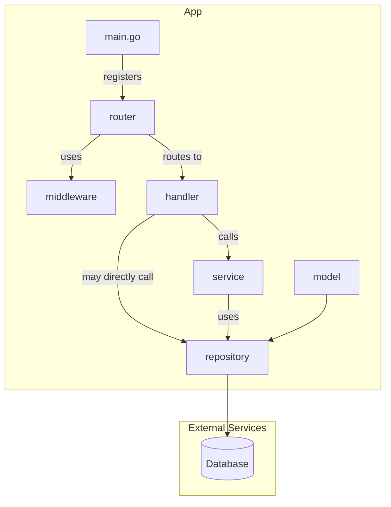
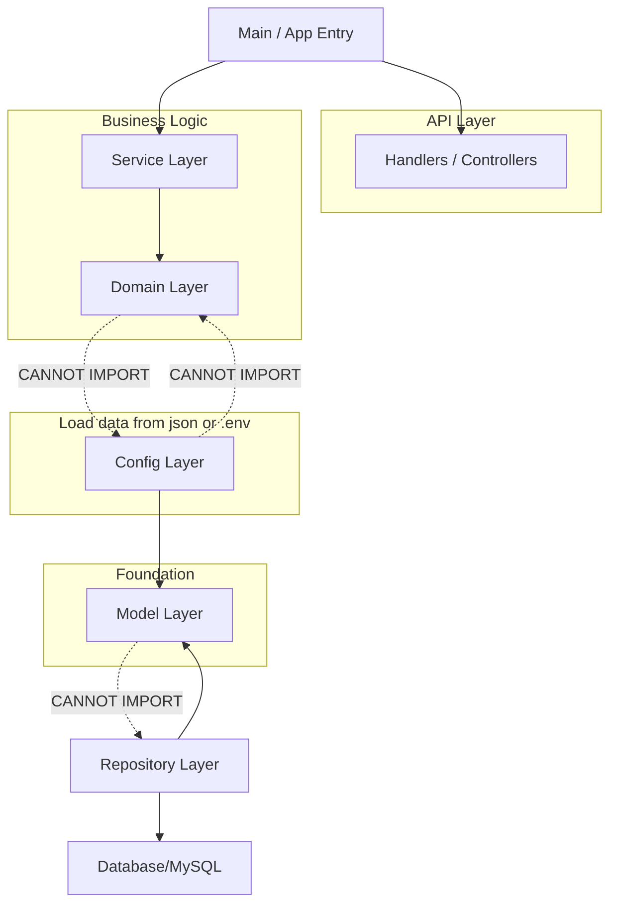

# Golang version API

This project is a mimic to the PHP api backend.

### Dependacy

[Fiber](https://gofiber.io/) web platform for Golang

[GORM](https://gorm.io/) ORM for communication with DB

[Validator](https://github.com/go-playground/validator/) for form validation

## Usage

Install Docker Desktop, and run

```docker compose up -d db adminer cache cachegui gofiber```

the line above IGNORE `elastic` and `kibana`
elastic and kibana is kind of optional for local devlopment. it is safe to launch without elastic most of the time


or you can always use

```docker compose up -d```

to launch all including `elastic` and `kibana`

Docker will launch Mysql, Redis, Adminer, and build/ run Golang project for you.

[Adminer for MySQL Access](http://localhost:7778/?server=db&username=root&db=gunraiders_classic) , and root account/ password is assigned at [docker-compose.yml](./docker-compose.yml)

For visit Redis any [GUI Tools](https://redis.io/docs/tools/) should work.

## Program flow

* main.go is where everything start, It create a Fiber app that with routers.
* /router hosts all the endpoint records. Each router uses several middlewares and handlers to serve endpoint request.
* /middleware are something shared between routers. most of time, they are use to authenticate user, check Administrator privillege, or validate inputs.
* /handler are real business logic resides. It reads/writes db data through Models.
* /model is data layer. It read/ write data with Database and form certain data array as response. Only this layer should use gorm.

### Hierarchy Rule
* Left nodes know everything about right nodes, i.e. routers can use any handler but handlers know nothing about routers.

Another example is: only model layer use GORM to communicate with DB, routers ask models to CRUD but have no knowledge about GORM/ORM/DB.

### Further relationship to avoid Circular Import

* The "Leaf" Rule (Model): The Model package is at the very bottom. It contains your structs (like EqRankInfo, UniqueEquipment, and SessionBase). It never imports anything from your project. This ensures that every other package can import it without starting a loop.

* The "Logic" Rule (Domain): The Domain contains your EquipmentFactory and business rules. It imports Model to know what an item looks like. It never imports Config. If it needs a "Rank Value" from a config file, the Service layer reads it from the Config and passes it into the Domain's function as a parameter.

* The "Loading" Rule (Config): The Config imports Model to define the type of data it's loading (like EqRankInfo). Since the Model doesn't import Config back, there is no cycle.

### Middleware

There are couple middlewares used between routers and handlers/controllers.
* [customauth](./middleware/customauth.go) retrieves request header's Authorization field and checks existence in Session.
* [privilege](./middleware/privilege.go) is for checking Admin privilege.


