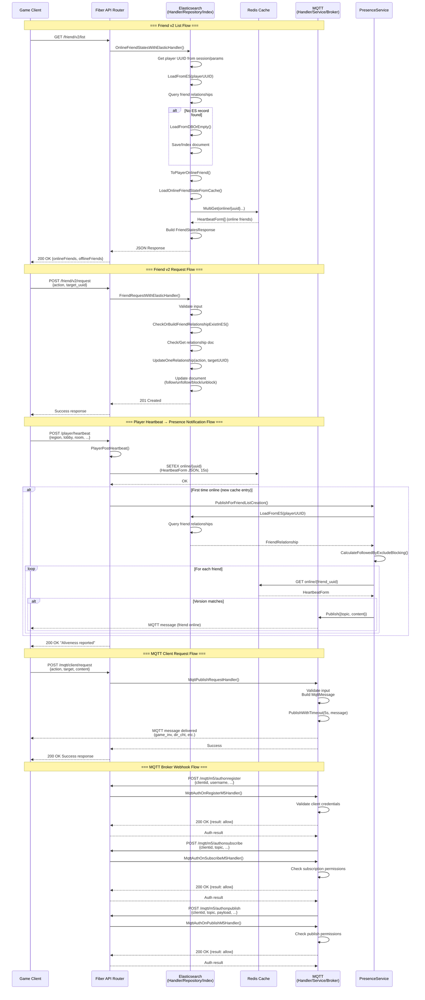

# Friend v2 + MQTT + Elastic/Backend Sequence Flow

## Sequence Diagram: Friend v2 Endpoints & MQTT Integration



## Key Flows Summary

### 1. **Friend List v2** (`GET /friend/v2/list`)
- Loads friend relationships from **Elasticsearch**
- Checks online status from **Redis cache** (`online/{uuid}`)
- Returns combined online/offline friend list

### 2. **Friend Request v2** (`POST /friend/v2/request`)
- Updates friend relationships directly in **Elasticsearch**
- Supports: follow, unfollow, block, unblock actions

### 3. **Player Heartbeat** (`POST /player/heartbeat`)
- Saves player state to **Redis** with 15s TTL
- Triggers **PresenceService** to notify friends via **MQTT**
- Friends receive real-time online notifications

### 4. **MQTT Client Request** (`POST /mqtt/client/request`)
- Client publishes game invitations, direct chat via HTTP API
- API forwards to **MQTT Broker** for delivery

### 5. **MQTT Broker Webhooks** (`/mqtt/m5/authon*`)
- **MQTT Broker** calls API for authentication/authorization
- API validates client permissions for register/subscribe/publish

## Data Flow: Online State Detection

```
Player Heartbeat → Redis (online/{uuid}) → Friend List Query → Redis MultiGet → Online Friends List
                                      ↓
                              MQTT Presence Notification → Friends' Clients
```

## Backend Components

- **Elasticsearch**: Stores friend relationships (follows, blocks)
- **Redis**: Caches player online state (`online/{uuid}` with HeartbeatForm JSON)
- **MQTT Broker**: Real-time messaging for presence notifications and game events
