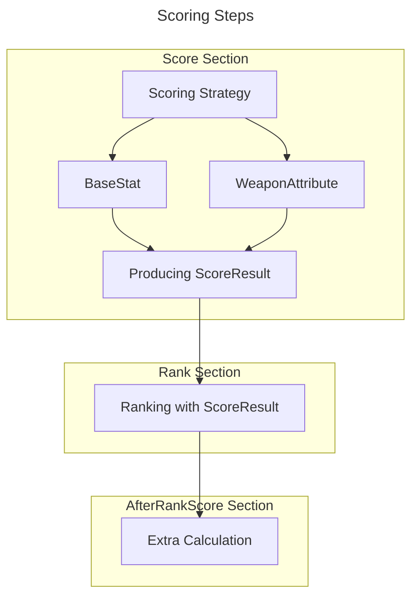

# Scoring Strategy

## data structs
```
type UniqueEquipment struct {
    gorm.Model
    Name             string                    `gorm:"type:varchar(128)" json:"name"`
    OwnerID          string                    `gorm:"type:varchar(48) CHARACTER SET utf8mb4 COLLATE utf8mb4_general_ci;index" json:"owner_id,omitempty"`
    BaseStat         []WeaponAttributeModifier `gorm:"-" json:"eq_stat"`                           // Ignored by GORM, used in code
    WeaponAttributes []WeaponAttribute         `gorm:"many2many:unique_eq_attributes;" json:"wpn_atr"` // NO Back-Reference!
}
```

for each EQ, its stats are form from two group `BaseStat` and `WeaponAttributes`.

**BaseStat** are random picked from json-config.

**WeaponAttribute** are predefined db records, two other db tables `weapon_attributes` and `unique_equipment_weapon_attributes` are defined with UniqueEquipment.

```
type ScoreResult struct {
	Raw int // The original score
	Avg int
}

type EquipmentStanding struct {
	Score          ScoreResult       `json:"score"`
	Rank           myCFG.EqRankRange `json:"rank"`
	AfterRankScore int               `json:"after_rank_score"`
	StandingAt     string            `json:"timestamp,omitempty"` // optional for time-based snapshot
}
```
Score and Rank are stored in EquipmentStanding.

## Scoring and ranking Steps




### Score section
- Scoring with **BaseStat**
- Scoring with **WeaponAttribute**
- Producing **ScoreResult** from above

### Rank section
- Ranking with **ScoreResult**

### AfterRankScore section
- extra calculate with **ScoreResult** and **Ranking**
